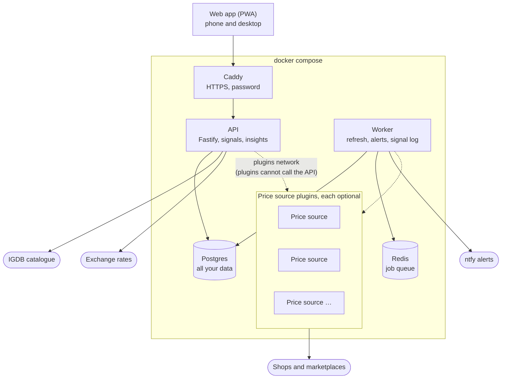
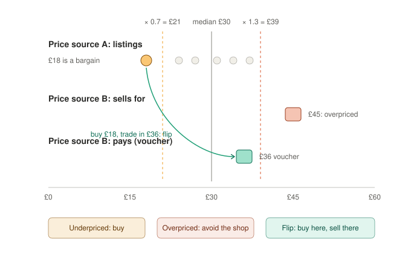

# RetroWatchdog

A self-hosted retro game collection manager and price tracker: your
collection and your price hunts, in one place.

RetroWatchdog keeps track of the games you own and the ones you are after.
It watches the shops and marketplaces you buy from, tells you when a copy on
your list turns up at a good price, and tells you when a game you own is worth
selling. Every number it shows says where it came from and how sure it is.

It is a personal tool you run yourself: one `docker compose` stack on a
computer at home, a mini PC or a server, opened from the browser on your phone
or your desktop. Your collection stays on your machine.

## What it does

- **Collection.** Every copy you own, with what you paid, its region,
  condition and grade, and what it is worth today in the currency you choose.
  Value history, realized profit on what you sold, and CSV import and export.
- **Watchlist.** The games you are hunting, each for the exact state you want
  (say, PAL and complete) or any. A target price per watch.
- **Good prices, as they appear.** A listing well under the market, a shop
  asking too much, a copy you could buy here and trade in there, a copy you
  own that a shop now pays well for. Each one shows the two prices it compared.
- **Recommended actions.** Built on months of prices and what you paid:
  "sell now, it is the best payout in 90 days", "buy now, it is the lowest in
  90 days", "your target is never met, raise it", plus clean-ups for watches
  that never move.
- **Insights.** Every recommendation by kind, how often past signals turned
  out right, and the price history of your collection and your watchlist.
- **Alerts on your phone** through [ntfy](https://ntfy.sh), when something
  worth acting on appears.
- **Any currency** the exchange-rate provider quotes; amounts stay as each
  shop quoted them.

The app never claims more than the data supports. eBay prices are active
listings, not sales, and every screen says so. A market with too few listings
says "not enough listings" instead of inventing a median. A boxed game without
its manual is never priced as complete.

## How it is built



The app has no price source of its own. Prices come from **plugins**: small
separate services, each in its own repository, that fetch from one shop or
marketplace and hand the app raw rows. You install only the ones you want, and
the app stores nothing from a plugin until you have approved what each of its
prices may be used for. Anyone can write a plugin for another shop: the
[protocol](docs/sidecar-protocol.md) is documented, and a new plugin is added
from Settings without a rebuild.

| Plugin | Repository | Markets | What it provides |
| --- | --- | --- | --- |
| CeX | [retrowatchdog-cex-plugin](https://github.com/uniplexed/retrowatchdog-cex-plugin) | UK, Spain, Ireland | Each shop's sell price and its cash and voucher offers |
| eBay | [retrowatchdog-ebay-plugin](https://github.com/uniplexed/retrowatchdog-ebay-plugin) | UK, DE, ES, FR, US | Active fixed-price listings and their median, with your own free key |
| Vinted | [retrowatchdog-vinted-sidecar-plugin](https://github.com/uniplexed/retrowatchdog-vinted-sidecar-plugin) | UK, France, Germany, Spain, Ireland | Private sellers' asking prices, through a community scraper |
| Wallapop | [retrowatchdog-wallapop-sidecar-plugin](https://github.com/uniplexed/retrowatchdog-wallapop-sidecar-plugin) | Spain, Italy, Portugal | Private sellers' asking prices near a city you choose, through Wallapop's web API |

The game catalogue, one entry per game and platform, comes from IGDB.

## How a good price is spotted



Each market is compared within the same region and condition. The median of
the listings is the baseline; a price under 0.7 × the median is a bargain, a
shop over 1.3 × is overpriced, and a trade-in worth more than the buy price
times the flip margin is a flip. Every threshold is yours to change in
Settings → Barks (Signals). [How the signals work](docs/signals.md) has the details.

## Install

The [installation guide](docs/install.md) walks through it step by step. On a
Linux machine with an internet connection, one command does it all: it
installs Docker if needed, asks a few questions and starts the app.

```bash
curl -fsSL https://raw.githubusercontent.com/uniplexed/retrowatchdog/main/scripts/install.sh | bash
```

On Windows, in PowerShell (it offers to install Docker Desktop if needed):

```powershell
irm https://raw.githubusercontent.com/uniplexed/retrowatchdog/main/scripts/install.ps1 | iex
```

By hand, with Docker already installed:

```bash
mkdir retrowatchdog && cd retrowatchdog
curl -fsSLO https://raw.githubusercontent.com/uniplexed/retrowatchdog/v1.0.0/docker-compose.yml
curl -fsSL https://raw.githubusercontent.com/uniplexed/retrowatchdog/v1.0.0/.env.example -o .env
docker compose pull
docker compose up -d
```

`COMPOSE_PROFILES` in `.env` says which plugins to start. The app and each
plugin are published images (`ghcr.io/uniplexed/retrowatchdog-*`). No plugin
ships credentials: the CeX plugin needs CeX's public search key and the eBay
plugin your own developer keys, each explained in that plugin's README.

The web app answers on ports 80 and 443. Open it, then:

1. **Settings → Plugins** lists the plugins you started as pending
   proposals. Open each, read what it claims, and tick the price kinds you
   accept. The `reference` role marks the baseline every other price is
   judged against, so it starts unchecked; eBay's median is the one it
   belongs on.
2. **Settings → Markets** switches the approved markets on.
3. Search a game, add it to your collection or your watchlist. CeX's first
   catalogue sweep takes a few hours; eBay, Vinted and Wallapop answer live when a game
   is opened.

### HTTPS

The web container is Caddy. It serves plain HTTP on port 80 for any host name
and HTTPS on 443 for the names in `PUBLIC_HOST`:

- For `localhost`, an IP address or a bare host name, Caddy issues the
  certificate from its own authority. `https://<host>/root.crt` serves that
  authority's certificate for clients to trust once; a client that trusts it
  can install the site as an app.
- For a real domain, Caddy obtains a Let's Encrypt certificate by itself, and
  clients need nothing.

### Password

The app has no user accounts. To keep anyone else out, put a password in
front of it; this is required before you expose the app beyond a private
network, since every screen can write.

1. Make a hash of the password:

   ```bash
   docker run --rm caddy:2-alpine caddy hash-password --plaintext 'your password'
   ```

2. Put it in `.env` as `APP_PASSWORD_HASH` with every `$` doubled to `$$`
   (compose would otherwise read `$2a` as a variable and truncate the hash,
   locking everyone out), and the user name as `APP_USER` (default `retro`).
   The installer does the doubling for you.
3. Recreate the web container: `docker compose up -d web`.
4. To check, open the app: the browser asks for the user and password once
   and remembers them. `https://<host>/root.crt` stays open, so a new client
   can trust the certificate before it logs in.

### Keys

Every key is optional. With none, the app keeps your collection and your
watchlist but shows no prices: every price comes from a plugin you switch on,
and nothing is read from any shop or marketplace until you do.

| Key | Where | What it unlocks |
| --- | --- | --- |
| `IGDB_CLIENT_ID`, `IGDB_SECRET` | `.env` | Searching for games not yet in the local catalogue. Free at [dev.twitch.tv](https://dev.twitch.tv). |
| `EBAY_CLIENT_ID`, `EBAY_CLIENT_SECRET` | `.env.ebay` | eBay's five markets, and the median the barks (signals) judge against. Free at [developer.ebay.com](https://developer.ebay.com), under eBay's API License Agreement. |
| `CEX_ALGOLIA_APP_ID`, `CEX_ALGOLIA_API_KEY` | `.env.cex` | The CeX plugin, if you choose to run it; see its [README](https://github.com/uniplexed/retrowatchdog-cex-plugin) and the [legal notes](LEGAL.md) first. |
| none; optional `VINTED_SITES` | `.env.vinted` | The Vinted plugin, if you choose to run it: no key, all five sites by default (`uk,fr,de,es,ie`; `VINTED_SITES` narrows them). Vinted's terms forbid scraping without its authorization; see its [README](https://github.com/uniplexed/retrowatchdog-vinted-sidecar-plugin) and the [legal notes](LEGAL.md) first. |
| none; optional `WALLAPOP_LOCATION_ES`, `_IT`, `_PT` | `.env.wallapop` | The Wallapop plugin, if you choose to run it: no key; each country searches from its capital unless you give your city as `latitude,longitude`. Wallapop's terms require its authorization; see its [README](https://github.com/uniplexed/retrowatchdog-wallapop-sidecar-plugin) and the [legal notes](LEGAL.md) first. |
| `NTFY_TOPIC` | `.env` | Notifications for new watchlist signals through [ntfy](https://ntfy.sh): subscribe a device to a long random topic name and put the same name here. |

A plugin's settings and secrets live in `.env.<plugin>` beside `.env`,
never in the app's own file. `.env.example` documents every other setting.

## Working on it

The pnpm dev servers run against the containerised database and queue:

```bash
docker compose -f docker-compose.yml -f docker-compose.dev.yml up -d postgres redis
pnpm install
pnpm --filter @retrowatchdog/api migrate
pnpm dev:api        # http://localhost:3001
pnpm dev:web        # http://localhost:5173, proxies /api to the dev API
pnpm --filter @retrowatchdog/api worker
```

`docker-compose.dev.yml` publishes Postgres, Redis and the API on loopback for
this; the shipped `docker-compose.yml` publishes nothing but the web ports.
Stop the containerised API first if it runs with the dev file; it also binds 3001.

```bash
pnpm -r test
pnpm -r typecheck
```

The API tests need the postgres container and create a `retrowatchdog_test`
database. Each plugin's tests run in its own repository.

## Where to read next

- [Operating guide](docs/operating-guide.md): every setting and screen, the
  currency model, valuation, alerts, the plugin system and the RetroWatchdog
  plugins, adding a console, the catalogue sync.
- [Installation guide](docs/install.md): from a bare machine to the first
  game, step by step.
- [Barks (Signals)](docs/signals.md): what each signal means, the rules and
  thresholds behind it, and how to tune them.
- [Source plugin protocol](docs/sidecar-protocol.md): the contract a plugin
  implements, version 3.
- The plugins' own READMEs, in their repositories (linked above).
- [Roadmap](docs/ROADMAP.md): what is deferred, and what would make it worth
  doing.
- [Changelog](CHANGELOG.md).

## About the sources, and the law

Read [LEGAL.md](LEGAL.md) before you install: no warranty, not financial
advice, no affiliation with any shop or marketplace named here, what each
source's terms say and what that makes you responsible for. The short
version, checked against each source's own terms on 2026-10-18 (terms
change, so check them again when you install; none of this is legal advice):

- **Vinted** forbids bots, scraping and data mining without its
  authorization ([terms](https://www.vinted.co.uk/terms_and_conditions)). The plugin scrapes. Get
  Vinted's authorization first.
- **Wallapop** forbids search robots and data extraction without its express
  written consent ([terms](https://about.wallapop.com/condiciones-de-uso/)). Get Wallapop's
  authorization first.
- **eBay** is an official API under its
  [API License Agreement](https://developer.ebay.com/join/api-license-agreement), which you accept when you
  register your keys. It wants eBay data kept fresh and shown apart from other
  sources, and forbids using it to model prices or for seller arbitrage; the
  [eBay plugin's README](https://github.com/uniplexed/retrowatchdog-ebay-plugin#terms-of-use-ebays-api-license-agreement-binds-you)
  lists the clauses that touch this app.
- **CeX** has no clause on automated access, but its catalogue is its
  property and, as a database, protected by UK and EU database rights; a
  nightly sweep of the whole catalogue is a systematic extraction. Keep it
  to your own use, or ask CeX.
- **IGDB** is free for non-commercial use only ([API docs](https://api-docs.igdb.com/)).
  Running RetroWatchdog for yourself is fine; a commercial deployment needs
  IGDB's partnership and visible attribution.
- **PriceCharting** allows its price data for personal use, never in software
  other people can reach ([terms](https://www.pricecharting.com/page/terms-of-service)). The collection
  import reads your own public collection page and notes each copy's value at
  import; keep that deployment yours.
- **Frankfurter** (rates) and **ntfy** (alerts) are free for any use.

All unofficial channels are paced and circuit-broken, for personal use.
CeX, Vinted and Wallapop are off by default in the installer; you choose to
switch them on. Every number the app derives from these prices is an
automatic calculation over what it stored, not an appraisal and not
financial advice.

## Security

The app has no user accounts. Before anyone else can reach it, set a password
(above). The API answers only to the names in `PUBLIC_HOST`, IP addresses and
`localhost`, refuses changes sent from other sites, and refuses every request
from the plugins' own network, so a plugin cannot drive it. Report a security
problem privately through GitHub's "Report a vulnerability" on this
repository.

## License

RetroWatchdog is free software under the [GNU Affero General Public License
v3.0](LICENSE), **as is and without warranty** (licence sections 15 and 16).
Anyone may run, study, change and share it; whoever offers a changed version
to others, including over a network, must offer them its source under the
same licence. For uses the AGPL does not fit, the author offers a separate
[commercial license](COMMERCIAL-LICENSE.md) for the application; the plugins
stay AGPL-3.0 only. Contributions are welcome under the terms in
[CONTRIBUTING.md](CONTRIBUTING.md).
